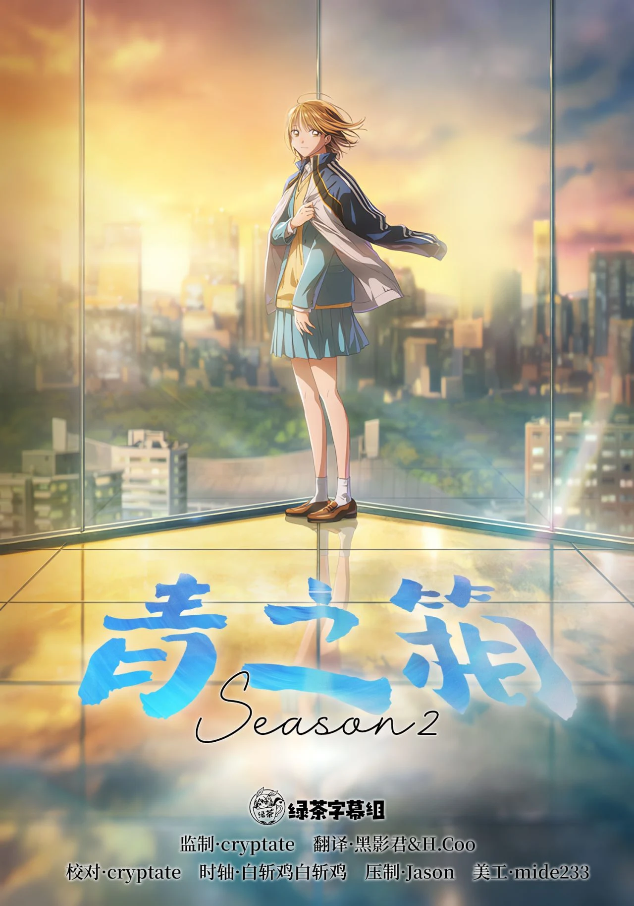

  

# 青之箱 第二季

猪股大喜是初高中一体的体育强校荣明高中男子羽毛球队的成员，喜欢上了每天晨练时都会见到的高二学姐鹿野千夏。因父母赴海外工作，千夏寄住进猪股家，两人的关系从晨练同伴逐渐升温。社团、恋爱与学业交织的新季节就此展开。

## 字幕说明

- `JPSC`：日文原文 + 简体中文
- `JPTC`：日文原文 + 繁體中文

## 文件列表

（字幕待官方字幕包发布后补充）

## 字体下载

（待补充）

## Staff

| 职位 | 人员 |
| --- | --- |
| 监制 | cryptate |
| 翻译 | 黑影君  H.Coo |
| 校对 | cryptate |
| 时轴 | 白斩鸡白斩鸡 |
| 压制 | Jason |
| 美工 | mide233 |
