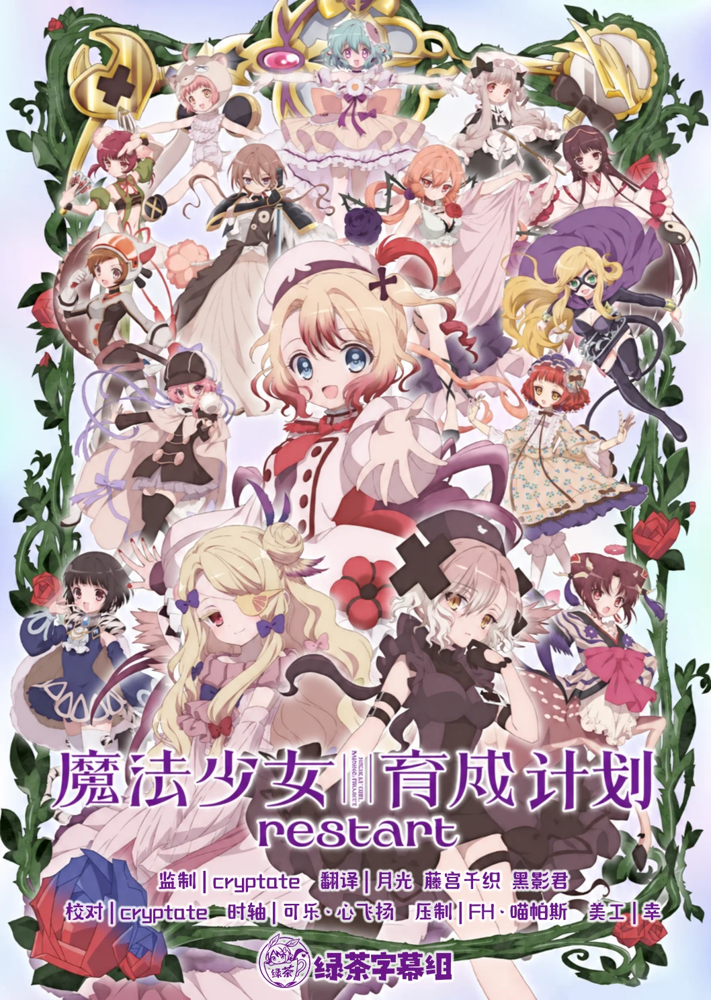

  

# 魔法少女育成计划 restart

在不为世人所知的「魔法之国」，被选中的少女会被授予固有的魔法之力。会使用「让料理变得美味」魔法的蓓蒂卡，与其他 16 位素不相识的魔法少女一起，被迫参加一场神秘的虚拟游戏——那本应是安全的训练，却成了设计好的噩梦开端。

## 字幕说明

- `JPSC`：日文原文 + 简体中文
- `JPTC`：日文原文 + 繁體中文

## 文件列表

（字幕待官方字幕包发布后补充）

## 字体下载

（待补充）

## Staff

| 职位 | 人员 |
| --- | --- |
| 监制 | cryptate |
| 翻译 | 月光  藤宫千织  黑影君 |
| 校对 | cryptate |
| 时轴 | 可乐·心飞扬 |
| 压制 | FH·喵帕斯 |
| 美工 | 幸 |
