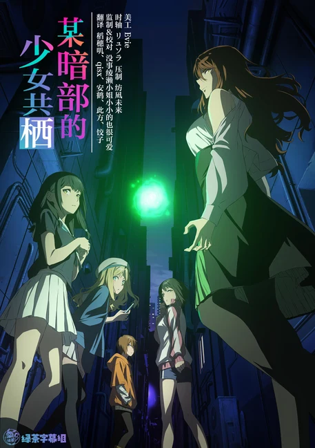

  

# 某暗部的少女共栖

学园都市人口约二百三十万，其中八成是学生，为开发超能力而实施着特殊课程，能力从「无能力（Level 0）」到「超能力（Level 5）」共分六级。在这座拥有远超世间常识的科学技术、看似梦一般的城市阴影里，暗部的少女们执行着不能见光的任务。

## 字幕说明

- `JPSC`：日文原文 + 简体中文
- `JPTC`：日文原文 + 繁體中文

## 文件列表

（字幕待官方字幕包发布后补充）

## 字体下载

（待补充）

## Staff

| 职位 | 人员 |
| --- | --- |
| 美工 | Eve |
| 监制 | 没事绫濑小姐小小的也很可爱 |
| 翻译 | 稻穗叽  qisx  安鹤  此方  饺子 |
| 校对 | 没事绫濑小姐小小的也很可爱 |
| 时轴 | リュウ |
| 压制 | 纺凪未来 |
